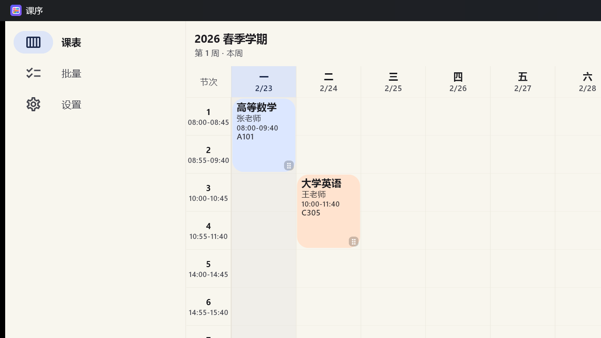
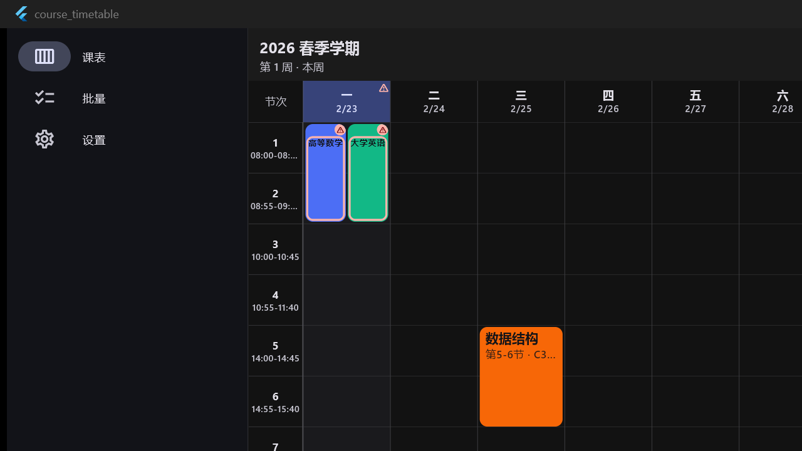
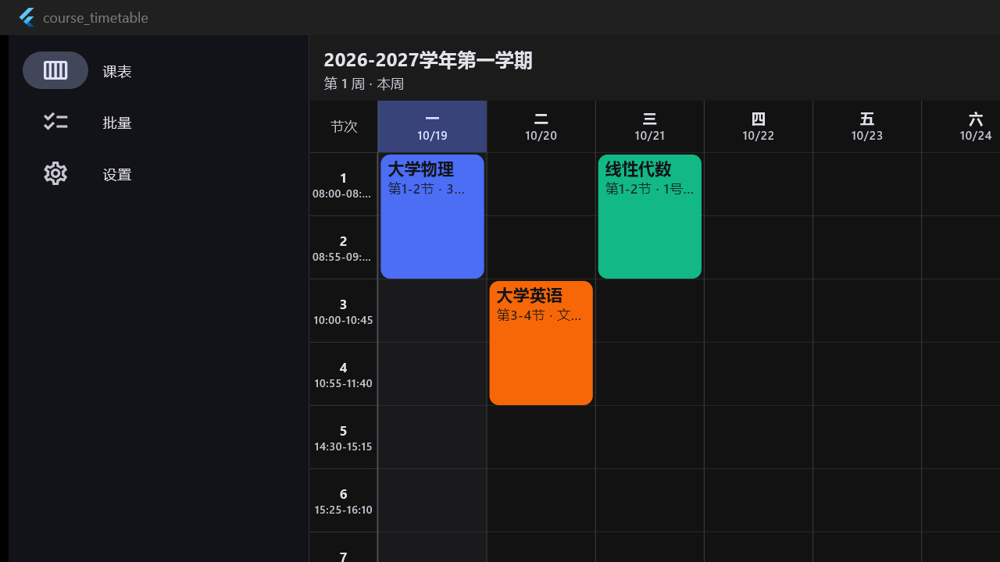

# 课序 · Kexu

<p align="center">
  
</p>

> **不规律的课表，也有自己的顺序。**

一款面向大学生的**课表 App**，一套 Flutter 代码同时运行在 **Android** 和 **Windows**。
整体界面采用 **ColorOS 16 设计语言**：深色近黑 / 浅色浅灰背景、24px 大圆角卡片、
ColorOS 蓝强调色、胶囊按钮与浮动底栏，页面切换为淡入过渡。
日程页额外使用农历月历与可收缩日历。

针对的核心痛点是：**大学课程极不规律** —— 单周/双周、断续周次（3-5 周 + 7-9 周）、
一门课一周上多次、临时调课补课。多数课表 App 只支持「第 1-16 周」，本项目从数据模型
层面就把「不规律」当作一等公民。



> 上图是预置数据的运行截图：第 1 周只显示了「高等数学」（单周课）和「大学英语」，
> 而「数据结构」（第 3-9 周）与「物理实验」（第 2/4/6/8 周）正确地没有出现 ——
> 这正是「极不规律课表」逻辑生效的直观证据。



> 上图演示**冲突处理**：「高等数学」与「大学英语」被排在同一时间（周一 1-2 节、
> 周次完全重叠）。两门课**横向并排各自完整显示**（而不是叠在一起只露一个），
> 并带警告色描边与警告图标。



> 上图是主界面：右下角「AI」是 AI 助手入口（支持上传图片）；顶栏「添加」负责新增课程。


> 上图是课表在 Windows 端的实际渲染。

---

## 功能

### 0. 首次使用向导
首次启动进入五步向导：

1. **设置学期与作息**：先确认学期起始日与总周数，再从 GitHub 学校模板导入该校全部作息；
2. **配置大模型 API**：查看视觉 / 语言模型状态，可打开配置页；
   也可直接点「跳过 AI 设置，稍后再配」，没有 API Key 也能继续；
3. **设置节假日（可选）**：入口在「设置 → 学期与作息 → 节假日」，可手动添加放假日期，
   或点「用 AI 设置节假日」一句话解析；也可以直接跳过；
4. **选择添加课程方式**：图片转课表、AI 助手（改课表 / 加日程）、手动添加三种入口说明；
5. **课表编辑与新增**：长按空白新增/拖拽选节次、长按课程编辑、拖动调整、撤销与重做。

顶部「跳过」可随时完成向导；完成后不再自动弹出。
课表「更多 → 使用教程」打开独立的 6 节教程（宽屏带目录，可直接跳章）。

### 1. 精确表达不规律课表
- **周次用显式列表存储**（如 `[1,2,3,5,6]`），而不是「起始周 + 单双周」这种有损压缩，
  因此任何组合都能精确表达。
- 支持单周、双周、断续区间、零散周次；展示时自动压缩成人能读的形式
  （`[1,3,5,7]` → `1-7周(单)`，`[1,2,3,5,6]` → `1-3,5-6周`）。
- **一门课可有多个上课时段**（周一 1-2 节 + 周三 5-6 节，各自独立的周次与地点）。
- 建模了**调课 / 停课 / 补课**（`Adjustment`）。
- 可自定义每所学校的**作息时间**（第 N 节的起止时间）与**学期**（第 1 周周一、总周数）。
- **支持多套作息方案**：不少学校夏季与冬季作息不同（比如夏季下午 14:30 上课、冬季 14:00）。
  可以建多套方案（夏季作息 / 秋季作息），各自设置节次时间与**生效日期区间**，
  App 会按日期自动切换到当天生效的那套 —— 周视图里的时间轴也会跟着变，
  不需要每年手动改两次。
- 课程编辑的**开始节 / 结束节下拉直接显示该节的作息时间**（如「第 1 节 08:00-08:45」）。
- **作息模板托管在 GitHub**：先按学校浏览，进入学校查看详细作息，支持整套导入、搜索与内置加速镜像。
- 课表**课程卡片与课程详情的「节次」**也显示该时段作息时间（如 `08:00-09:40`）。
- 课表支持**左右划动切换周次**，并带滑入 + 淡入动效。
- **长按课程卡片**可直接打开编辑页修改课程信息；**拖动卡片右下角的拖动柄**可在同一周内
  自由拖到任意星期与节次（保持跨节数不变，拖出上下边界会自动贴边；拖动时显示目标时间段，
  拖卡片正文不会误触）。
- **长按课表空白单元格**会在点击的星期与节次打开新增课程页，星期和节次已预填；
  **按住继续上下拖动**可一次选中连续几节，松开后按范围预填。
- **使用教程**：课表「更多 → 使用教程」打开 6 节图文教程：
  1. 认识课表：周次切换、回到本周、看懂课程块；
  2. 添加课程：长按空白格、菜单添加、图片 / AI；
  3. 编辑与调整：长按编辑、拖动换时间、多时段、撤销重做；
  4. 日程与提醒：月历、新建日程、AI 加日程、上课提醒；
  5. AI 助手：同一个窗口改课表 / 加日程、发图片、先预览再应用；
  6. 设置与数据：学期作息、主题、数据备份、检查更新。
  宽屏（Windows / 平板）左侧显示教程目录，可直接跳到任意一节；手机端为分节进度条。
- **冲突课程横向并排**：同一天里节次相交的课程自动分栏并排显示，不再纵向叠在一起互相遮挡；
  不相交的课程仍占满整列宽度。

### 2. 图片转课表（大模型 API）
上传教务系统截图或课表照片 → 视觉大模型识别 → **草稿预览（可逐门勾选）** → 确认导入。
识别结果不会直接落库，避免模型幻觉污染真实课表；每条草稿的解析告警（缺失周次、
无效时段等）都会显式列出。

**一次可选多张图片同时识别**（最多 9 张，支持一次多选或分多次追加），适合这些场景：

- **分页 / 分屏截图**：一页放不下的课表拆成两张图，识别后自动合并成一份课表；
- **单周 + 双周两张截图**：同名课程、同一天同起止节次的时段会合并，**周次取并集**，
  正好拼成完整周次；
- **多图重叠**：两张图里重复的课时不会变成重复课程（按「课程名 + 星期 + 起止节次 + 地点」去重）。

实现上按每次请求最多 4 张分批发给视觉模型，每批结果在客户端跨批合并，因此
**某一批失败不会让整次识别失败**（会单独提示「第 N 批识别失败」）。
无论几张图，仍然保留「草稿核对」这一步，确认后才写入课表。

### 3. 批量添加 / 编辑 / 删除
多选课程后批量改周次、改地点、改颜色、删除、复制到指定周次范围。支持按星期、
按周次、按关键字筛选。入口在课表顶栏「更多 → 批量修改」。

### 3.1 日程
底部第二个页签是「日程」，是一个**独立于课表的月历**，用来标注考试、作业截止、活动、
会议等个人事项。日程页按 **ColorOS 16** 的设计语言重写：

- 深色/浅色自适应：近黑背景、24px 大圆角卡片、ColorOS 蓝强调色；
- 顶部大号「2026年3月」标题 + 当前教学周，右侧 AI 与更多菜单；
- **月历可左右滑动切月**，也可以上下拖动或点日历下方箭头，在整月与单周之间收缩；
- 每个日期显示农历 / 节气 / 节日，有日程的日期下方显示蓝点；
- 选中日期显示「今天 / N 天后 / N 天前」、农历日期与当天日程；
- 检测到重复日程时显示提示条，可一键合并；
- 新建/编辑页同样是 ColorOS 风格：取消 / 新建 / 完成、大标题输入卡、全天开关、
  日期与时间、备注；
- 日程保存在独立的 `schedule_events.json`，不影响课表与同步数据。

### 3.1 同一时段多课并存 + 冲突高亮
大学课表经常**同一时间排了两门课**（不同周次，或教务系统硬排冲突）。
本项目不会把它们叠在一起只显示一个角标：

- **同一格内的多门课横向并排**，每门课都完整显示（宽度不足时自动降级为只显示课程名，
  换行 + 省略号并**保持可读字号**，**保证不出现 overflow**）。
- **卡片默认显示教师与教室**（不用点开详情）；手机窄列放不下时按
  「课程名 → 教师 → 教室 → 周次」的优先级保留，被舍弃的信息在详情弹层里仍可看到。
- **冲突课程高亮**：`colorScheme.error` 描边 + 右上角警告图标，tooltip 标注「时间冲突」；
  所在星期列的表头也会出现警告标记。
- **冲突判定很严格**：同一天 + 节次区间相交 + **周次相交**，三者同时满足才算冲突。
  因此「单周在 A 教室、双周在 B 教室」这种合法排法**不会被误报**。

### 4. 统一 AI 助手（改课表 + 加日程）
**入口是课表主界面右下角的「AI」悬浮按钮**：点击后以按钮为中心渐变扩散到全屏，
进入类似手机助手的毛玻璃对话界面。同一个窗口处理两类事情：

- **改课表**：用日常说法描述改动（如「把明天的课都挪到下周」「高数改成单双周都上」），
  大模型把意图翻译成结构化操作方案，用户逐条核对后再一键应用；
- **加日程**：直接说「明天下午 3 点交高数作业」「下个月 5 号报名截止」，
  AI 解析出日期、时间、标题与备注，预览确认后写入日程；
- 日程页右上角「AI」打开的也是同一个 AI 窗口，不再有单独的日程 AI。

- **可以直接发图片**：AI 界面左下角可附加课表截图；有语言模型时图片直接发给语言模型，
  没有语言模型时先用识图模型把图片转述成文字，再据此生成方案；
- **毛玻璃助手界面**：渐变背景 + 背景模糊的半透明气泡/输入框/方案卡片，
  顶部显示「现在」的日期与教学周；
- **按钮扩散动画**：从 AI 按钮中心向外扩散的渐变圆形揭示，打开时更像系统助手；

- **注入「现在」的时间上下文**：每次请求都会把当前日期时间、当前教学周、本周每天对应的日期、
  下一教学周，以及**当天生效的作息**（上午 / 下午 / 晚上各是第几节）一并交给模型。
  因此「今天 / 明天 / 下周三 / 下午第几节」这类相对说法会被换算成
  `dayOfWeek + 显式周次`；跨周也不会算错（例如周日说「明天」= 下一教学周的周一）。
- **容忍白话、简称与不精确描述**：不要求用户说规范术语。「高数」→ 高等数学、
  「线代」→ 线性代数、「英语」→ 大学英语；模型输出后本地还会用课程名模糊匹配再校验一次
  （全角/半角、括号、错别字、子序列缩写都能对上），**唯一命中才改写**，避免改错课。
- **AI 会反问澄清**：缺少「改哪门课」「改成什么」这类关键信息时先追问，
  并给出可直接点选的候选（例如课表里同时有「高等数学（上）」「高等数学（下）」）。
- **多轮对话式修改**：追问与回答在同一个对话里继续，历史会作为独立消息带给模型，
  用户点一下候选就能接着改，不必重新打一遍完整指令。
- **也能直接改作息时间**：说「第 3 节改成 10:05 上课」「下午的课整体推迟 10 分钟」
  即可修改作息方案（可指定「夏季作息」等方案名；「上午/下午/晚上」会按作息换算成
  节次范围，只平移那几节，不会把全天一起挪）；AI 会区分「改作息」与「调课」，
  改作息不需要课程名；非法时间、平移后跨过 00:00 等会跳过并说明原因。
- **安全流程不变**：始终「先出方案 → 逐条勾选 → 应用」，模型不会直接写库。

### 5. 网盘双端同步
Android 与 Windows 之间通过网盘同步课表，**按课程粒度做三方合并**，
两端各自改不同课程不会互相覆盖。

- **WebDAV**：坚果云、Nextcloud、群晖、InfiniCLOUD 等，无需开发者资质。
- **自动同步**：启动时自动拉取；课表改动后自动上传（4 秒防抖 + 内容哈希去重）。

#### 同步是怎么处理冲突的
同步的难点从来不是传输，而是**冲突**。本项目采用「本地 / 远端 / 上次同步基线」
三方合并，判断依据是**内容哈希而不是时间戳** —— 多设备的时钟不可信，
拿时间做判据会得出错误结论。

| 情形 | 处理方式 |
|---|---|
| 只有一端改了某门课 | 采用改动的那一端 |
| 两端各改**不同**课程 | 两处改动都保留（核心场景） |
| 一端新增、另一端删除别的课 | 新增与删除都生效，互不干扰 |
| 两端**都改了同一门课** | 保留本机版本，并在同步页列出冲突 |
| 一端改了、另一端删了 | 保留改动（避免丢失新内容），并列出冲突 |
| 两端都删了 | 保持删除，不会「复活」 |

合并结果是**收敛**的：内容相同但课程顺序不同不会被视为差异，
因此不会出现反复上传的同步抖动。

### 6. 在线更新（GitHub Releases）
应用内自带更新检查与安装，**更新源就是 GitHub Releases**：仓库地址默认写死为本仓库
`NKBaa/kexu`（`app/lib/data/models/update_config.dart` 的 `defaultUpdateRepo`），
开箱即用；fork 之后可以在设置里改成自己的仓库。

- **仓库地址**：`设置 → 检查更新` 里默认已填 `NKBaa/kexu`，也可以粘贴完整仓库链接
  （会自动去掉 `https://github.com/` 前缀）。清空后不再发起任何网络请求，
  点「恢复默认」可还原。
- **国内镜像加速**：默认「自动」——先直连 GitHub，失败后依次尝试国内镜像；
  也可手动选直连、`ghfast.top`、`ghproxy.net`、`gh-proxy.com`，或填自定义前缀。
  规则很简单：**镜像地址 = 前缀 + 原始 GitHub 地址**（API 请求同理）。
- **检查与忽略**：手动检查会显示新版本号、发布时间、更新说明与安装包大小；
  「忽略此版本」之后不再提示该版本；「启动时自动检查更新」可以关闭，
  开启时只在发现新版本后用底部提示条轻提示一次（可点「查看」进入更新页），不打断使用。
- **下载与安装**：
  - **Windows**：`.exe` 直接启动安装程序；`.zip` 则打开所在文件夹，让你解压后运行。
    下载目录默认在「下载\课序更新」。
  - **Android**：下载 `.apk` 后调起系统安装界面；当前环境不允许直接安装时
    （如没给「安装未知应用」权限），会**自动回退到浏览器打开 Release 页面**手动下载。
- **版本号来源**：`app/pubspec.yaml` 的 `version`（当前 `1.2.46+102`），
  App 内展示的版本由 `app/lib/core/app_info.dart` 统一提供，
  并有测试保证两者一致（见下方「发布新版本」）。
- **只认正式版**：检查走 GitHub 的 `/releases/latest`，所以草稿（draft）与
  预发布（prerelease）不会被自动更新检测到；版本号相同也不算更新。

### 7. Android 桌面小组件、节假日与上课提醒
- **桌面小组件「今日课表」**：Android 桌面长按 → 小组件 → 找到「课序 / 今日课表」，
  即可在桌面看到日期、星期、教学周、今天课程与教室；有节假日时显示节日名称，
  当前正在上的课会高亮，下一节课会标「下一节」。点击小组件直接打开 App。
  - **自适应布局**：默认 4x4 显示 3 门课，拉高到 4x5 显示 4 门；课程卡片按可用高度自动撑满，
    只有 1~2 门课时不会在下方留大片空白；顶部显示课程数与周次，底部固定「更新于」；
  - 数据由 Flutter 侧压成快照后推给原生，原生只读快照渲染，**不依赖 App 常驻后台**；
  - 系统每 30 分钟重绘一次（用于刷新「正在上课」高亮），课表/节假日改动后打开 App 会立即同步；
  - 快照不是今天时显示「打开课序查看今日课程」，避免展示过期课程。
- **节假日管理**：`设置 → 学期与作息` 可添加/删除放假日期（如国庆节、校运会）。
  节假日当天课表显示「节假日」、不显示课程，上课提醒也会跳过这一天。
  也支持 **AI 设置**：点「AI 设置」，用一句话描述（如「国庆 10 月 1 日到 7 日放假」），
  AI 解析成日期列表后由你确认添加；首次向导的节假日步骤也提供同一入口。
- **上课提醒**：开启后按未来 7 天的课表排系统闹钟，上课前 5/10/15/30 分钟发通知；
  不需要 App 常驻后台。Android 13+ 会请求通知权限，Android 12+ 未授予精确闹钟权限时
  自动降级为不精确闹钟（可能晚几分钟，不会丢提醒）。
- **厂商活动卡片（实验）**：通知样式可选「系统通知」或「厂商活动卡片（实验）」。
  后者使用独立的高优先级渠道「课序活动提醒」并设置 `category=event`，
  尽量争取 OPPO / vivo / 小米等系统的横幅/卡片展示；**是否真的显示为厂商活动卡片
  由系统通知策略决定，App 无法保证**。国产 ROM 还可能需要手动开启自启动、后台运行、
  横幅通知与锁屏通知，设置页提供「打开系统通知设置」入口。
- **设置入口**：`设置 → 桌面小组件` 有添加步骤与「立即刷新小组件」按钮；
  `设置 → 学期与作息` 管理节假日；`设置 → 上课提醒` 管理提醒开关、提前分钟、
  通知样式与权限。

### 8. 课表分享（日历 / JSON 文件）
课表顶栏新增**分享按钮**，点开后可选两种文件：

- **日历文件（.ics）**：把每次课按实际日期展开成日历事件（含课程名、时间、教室、
  教师与节次），可直接导入手机/电脑日历；节假日当天的课不会写入；
  支持多套作息，按每天生效的作息换算起止时间。
- **JSON 文件**：完整课表数据（学期、课程、时段、作息），可备份或再次通过
  「数据管理 → 导入」恢复。
- 生成后调用系统分享面板，可发到微信、邮件、网盘或保存到文件；文件生成在临时目录，
  不会污染课表数据目录。

### 9. 推荐服务商：硅基流动 / CottonAPI
`设置 → 大模型配置` 顶部有两张**默认折叠**的推荐卡：
**硅基流动 SiliconFlow** 与 **CottonAPI**；点击卡片才展开注册/充值等入口，
平时只占一行，避免把配置页撑得很长。

- **硅基流动**：展开后可注册/登录、充值、查看 API Key 使用指南；

- **注册 / 登录**：打开硅基流动官方邀请链接
  `https://cloud.siliconflow.cn/i/DnX87B1j`（邀请人可能获得平台奖励，
  你的充值价格不受影响）。
- **创建 API Key**：登录后进入官方「API 密钥」页创建并复制。
- **充值**：在官方控制台按量充值；课序不参与支付，也不保存支付信息。
- **回到课序**：在视觉/语言模型详情页选择「硅基流动 SiliconFlow」预设，
  地址自动填 `https://api.siliconflow.cn/v1`，粘贴 Key 后点「获取模型列表」选择模型。
- **边界**：硅基流动没有面向第三方 App 的公开登录/OAuth SDK，因此课序不提供
  应用内账号登录或支付；账号密码、短信验证码与支付信息都不会经过课序，
  课序只在本机 `settings.json` 保存你粘贴的 API Key。
- **CottonAPI**：展开后可打开 [官网 / 注册](https://api.cottonapi.cloud) 或
  [充值页](https://api.cottonapi.cloud/wallet)；注册、充值与 API Key 都在官网完成，
  课序只保存你粘贴的 Key。

### 10. 模型能力名单（GitHub 自动更新）
模型能力名单**只用于给「获取模型列表」里的同名模型标注能力**，不再提供独立的
「按能力选内置模型」入口：

- **自动拉取**：打开模型详情页时自动从 GitHub 拉取 `templates/ai_models.json`，
  仓库按「设置 → 检查更新」配置，下载固定使用内置加速镜像；成功后会缓存到本地；
- **离线兜底**：网络失败时优先用本地缓存，再失败才用 App 内置的 30+ 模型名单；
- **能力标注**：填好 baseUrl / API Key 并点「获取模型列表」后，列表里命中名单的
  模型会显示「图片 + 文本 / 仅文本、上下文、免费、选型建议」；
- 未命中名单的模型照常显示，不影响选择；名单只做标注，不限制可填模型。

> 模型名单维护在仓库 `templates/ai_models.json`，新增/下架模型、修正能力标签
> 只需更新该文件并提交 `main`，App 下次打开模型详情页即可生效，不需要发新版。
> 模型是否可用最终以服务商「获取模型列表」返回结果为准。

### 11. 主题中心与主题市场
`设置 → 主题中心`：

- **主题模式**：跟随系统 / 浅色 / 深色；
- **内置主题**：ColorOS（默认）、午夜蓝、樱花、森林、高对比，点击立即应用；
- **自己写主题**：新建/编辑主题，用 JSON 代码描述浅色/深色色板与圆角，
  可预览、保存并应用；
- **主题市场**：从 GitHub `templates/themes.json` 拉取主题，安装后进入「我的主题」，
  更新主题无需发新版；
- 自定义主题保存在 `settings.json` 的 `customThemes`，当前主题记在 `activeThemeId`；
- 显示周末开关也收在主题中心。

> 主题市场维护在仓库 `templates/themes.json`，字段说明见 `templates/README.md`。

---

## 界面与入口结构

- **课表顶栏参考移动端课表**：
  - 左侧大号「第 N 周」+ 当天日期 `yyyy/M/d`，标题过长时自动缩放，不再省略；
  - 点标题打开周次选择，也可以左右滑动课表切换；
  - 右侧：回到本周 / 撤销 / 重做 / 更多；「更多」是带拖动条的底部面板，
    含添加课程、批量修改、分享、导入导出、使用教程。
  - 撤销/重做是 Word 式行为：只保留一条时间线，不再弹出「修改历史」列表；
    新的编辑会截断重做时间线。
  - 按钮 tooltip 与操作提示会带上细则，如「撤销：删除课程「高等数学」」；
    历史记录自动比较前后课表生成说明（新增/删除/修改课程、学期、作息）。
- **「添加」收在顶栏「更多」菜单里**：
  手动添加、图片转课表都收在这一个面板里。
- **「AI」是右下角悬浮按钮**：点击后从按钮中心渐变扩散打开毛玻璃 AI 助手，
  可改课表、加日程，也可直接附课表截图。
  两者位置互换，AI 作为高频入口更突出，并且只在课表页出现。
- **底部导航**：课表 / 日程 / 设置；批量修改收进课表「更多」。
- **时间/日期统一用滚轮选择器**：日程起止时间、作息每节时间、学期起始日、
  节假日日期、作息生效日期都使用底部滚轮 + 取消/完成，不再混用 Material 时钟弹窗。
- **精简重复入口**：日程页只保留右下角新建按钮，删掉日期标题旁的重复「添加」；
  日程 AI 与课表 AI 合并为同一个窗口。
- **设置是二级菜单**：设置首页只列出分类清单，点进去才是具体配置。
  新增一个设置分类只需往 `settingsSections()` 里**追加一条**（标题/图标/页面），
  不用改布局 —— 这是为后续持续加功能留的扩展点。

  当前分类：学期与作息 / 大模型配置 / 上课提醒 / 桌面小组件 / 数据管理 / 主题中心 / 检查更新 / 关于。

### 学期怎么定（按今天第几周反推）

进入 **设置 → 学期与作息**：

- 「第 1 周周一」点一下即可选日期，会自动归一化到所在周的周一；
- 只记得「今天是第几周」时，用「按今天定位」：填「今天是第 N 周」→ 点「定位」，
  App 会反推第 1 周周一（今天往前 `(N−1)×7` 天所在周的周一），并显示学期结束日期；
- 「总周数」决定学期范围，常见 16~20 周，可手填 1~60。

### 多套作息怎么配（夏季 / 秋季）

进入 **设置 → 学期与作息 → 作息方案**：

1. 点「新增方案」，命名（如「夏季作息」）。
2. 设置**生效日期**，例如 `05-01 ~ 09-30`；留空表示不限日期（常驻方案）。
3. 填这套方案的每节时间。
4. 再建一套「秋季作息」，区间设为 `10-01 ~ 04-30`。

切换规则：**限定日期的方案优先命中**，都不命中时回退到常驻方案。
周视图会按「该周周一的日期」挑选作息，所以跨过切换日的那一周会自动换时间轴。

### 修改历史与回退

- 每次改课表 / 作息 / 学期，都会在 `history.json` 里记录一份**修改前快照**，
  最多保留最近 **20 次**（内容没变化的保存会自动去重）。
- 课表顶栏新增「回退」按钮：打开修改历史后可「回退上一步」，
  也可以选择任一历史版本恢复；回退到旧版本后会丢弃比它更新的快照。
- 同步、导入、AI 批量修改同样会被记录；历史文件损坏或不可写不会影响课表保存。


---

## 技术栈
| 项目 | 选择 | 说明 |
|---|---|---|
| 框架 | Flutter 3.47.7 / Dart 3.13.5 | 单代码库覆盖 Android + Windows |
| 状态管理 | flutter_riverpod 2.x | `AsyncNotifier` 驱动的课表与设置状态 |
| 持久化 | JSON 文档（`path_provider`） | 见下方「为什么不用数据库」 |
| 网络 | `http` | 直接调用 OpenAI 兼容的 `/chat/completions` |
| 文件选择 | `file_picker` | 选图片、导入导出 JSON，双端支持 |
| 分享 | `share_plus` | 课表导出 `.ics` / `.json` 后调用系统分享面板 |
| Android 原生 | Kotlin + RemoteViews / AlarmManager | 桌面小组件、上课提醒、APK 安装（Flutter MethodChannel 桥接） |
| 打开链接 | `url_launcher` | 在线更新时打开 Release 页面 / 唤起安装包，双端支持 |

### 为什么不用数据库
课表数据量很小（几十门课、几十 KB）。把整份课表作为一个 JSON 文档**原子写入**
（临时文件 + rename，并保留历史备份）带来三个好处：Android/Windows 行为完全一致，
无需 sqflite 平台分支；批量操作与 AI 批量修改退化成简单的列表操作，不易出 bug；
天然支持整份快照备份与损坏恢复。数据量增长到需要索引时再换 SQLite 也不影响上层。

### 分层结构
```
lib/
  core/            工具与主题
    app_info.dart  应用名与版本号（唯一来源，与 pubspec.yaml 的一致性由测试守护）
    utils/         week_utils（周次解析/压缩，本项目核心算法）、json_utils（大模型输出容错）、ids
    theme.dart     主题与课程配色板
  data/            数据层（无 UI 依赖，可单测）
    models/        Semester / TimeSlot / Course / Session / Adjustment / Timetable
                   DraftCourse（AI 草稿） / AiOp·AiEditPlan（AI 操作） / AiConfig / AppSettings
                   UpdateConfig（在线更新配置：仓库、镜像、自动检查、忽略版本）
    local/         DocumentStore（原子 JSON 读写 + 备份恢复）
    repositories/  TimetableRepository / SettingsRepository
    services/      AiApplyService（把 AI 操作纯函数式地应用到课表）
                   UpdateService（GitHub Releases 检查 / 镜像下载 / 安装，网络可注入、可单测）
  features/
    timetable/     周网格主视图、课程卡片、provider
                   timetable_share_service（导出 .ics 日历 / .json 并系统分享）
    editor/        课程编辑器、时段编辑、周次选择器
    batch/         批量操作页（入口在课表「更多」）
    schedule/      日程页（月历 + 个人事项，支持 AI 设置）
    settings/      设置页、AI 配置、学期与作息表单、provider
                   semester_settings_page（学期/作息/节假日）
                   holiday_settings_card（节假日管理卡片）
                   holiday_reminder_page（上课提醒）
                   widget_settings_page（桌面小组件入口与刷新）
                   update_settings_page（检查更新：仓库/镜像/下载/安装）
    notifications/ 上课提醒：Dart 通道、未来 7 天排程生成
    widget/        桌面小组件快照生成与 Flutter ↔ 原生桥
    ai/            AiClient（OpenAI 兼容）、提示词、图片转课表、自然语言改课表、两个 AI 页面
                   now_context（「现在」的时间上下文：教学周 / 本周日期 / 当天节次）
                   course_matcher（课程名归一与模糊匹配，供本地校验用）
    import_export/ 数据导入导出
```

**关键设计：AI 只产出草稿，用户确认后才落库。** `DraftCourse` 与 `AiEditPlan` 都是
「待确认」的中间形态，`AiApplyService` 是纯函数（输入旧课表 + 操作 → 新课表 + 执行报告），
因此 AI 改课表可以预览、可以单测、不会写坏数据。

---

## 运行与构建

### 已构建好的产物

`tooling\build-all.ps1` 会把两个平台的产物按版本号归档到 `dist/`
（版本号取 `app/pubspec.yaml` 的 `version`，当前 `1.2.46+102` → 文件名用 `v1.2.46`）。
`dist/` 已在 `.gitignore` 里：**仓库只存源码，安装包作为 GitHub Release 资产上传**。

| 平台 | 路径 | 说明 |
|---|---|---|
| Windows | `dist/windows/kexu-v1.2.46-windows.zip` | 整个 Release 目录压缩，解压后双击 `course_timetable.exe` 免安装运行 |
| Android | `dist/android/kexu-v1.2.46.apk` | 传到手机安装（约 56 MB，当前用 debug 签名，仅供自用） |

> `dist/windows/` 下的解包目录（`course_timetable.exe` + `data/`）与 zip 内容一致，是 v1.2.46；
> 解压 zip 后直接双击 `course_timetable.exe` 即可运行。`dist/android/课表-v1.0.0.apk` 是历史版本，
> 保留作回滚用；当前版本是 `dist/android/kexu-v1.2.46.apk`（归档文件名统一用 ASCII，
> 避免 gh CLI 上传时把中文文件名吃掉）。

> 正式发布到应用商店前，请在 `app/android/app/build.gradle.kts` 里换成你自己的
> release 签名配置（当前用的是 debug 签名，方便直接安装试用）。

### 环境要求
- Flutter SDK（stable）
- **Windows 构建**：Visual Studio 2022 生成工具（含 C++ 桌面工作负载）+ Windows 10/11 SDK
- **Android 构建**：JDK 17 + Android SDK（`platforms;android-36`、`build-tools;36.0.0`、`platform-tools`）

### 常用命令
```powershell
cd app

flutter pub get

# 开发运行
flutter run -d windows
flutter run -d <android-device-id>

# 发布构建（建议用 ASCII 联接路径，见下方说明）
flutter build windows --release     # 产物：build\windows\x64\runner\Release\
flutter build apk --release         # 产物：build\app\outputs\flutter-apk\app-release.apk

# 测试与静态检查
flutter test
flutter analyze
```

### 本项目环境上的两个已知坑（重要）

**1) 项目路径含中文会导致 `flutter analyze` 崩溃，也会让 Android 构建直接失败**
- Dart 分析服务器在非 ASCII 路径下会抛 `FormatException`（路径被 URL 编码成 `%E8%AF%BE%E8%A1%A8`）。
- Android 的 Gradle 更严格，会直接报
  `Your project path contains non-ASCII characters`。
- Windows 的 MSBuild 也会因路径编码问题读不到中间产物。

解决办法是建一个 ASCII 联接路径，在其中进行构建与检查（文件是同一份）：

```powershell
cmd /c mklink /J C:\dev\kt "<项目路径>\app"
cd C:\dev\kt
flutter analyze
flutter build apk --release
```
> `tooling\build-all.ps1` 会自动建这个联接（并检测它是否指向了旧路径，指向旧项目时会重建）。

**2) Windows 构建需要符号链接支持**
Flutter 为插件创建符号链接，这需要「开发者模式」（需管理员开启）。
若无法开启，可用**目录联接（junction）**兜底 —— 它不需要管理员权限：

```powershell
# 一键构建脚本已内置上述两项处理
pwsh -File tooling\build-all.ps1
```

---

## 发布新版本（GitHub Release）

发版流程已经脚本化（在项目根执行，不需要 ASCII 路径），逐项检查清单见
[docs/release.md](docs/release.md)：

| 步骤 | 命令 | 作用 |
|---|---|---|
| 1. 改版本号 | 手工改两处 | `app/pubspec.yaml` 的 `version` + `app/lib/core/app_info.dart` 的 `appVersion` / `appBuildNumber` |
| 2. 构建 + 归档 | `pwsh -File tooling\build-all.ps1` | 构建双端产物并按版本号归档到 `dist/` |
| 3. 发布 | `pwsh -File tooling\release.ps1` | 用 gh CLI 创建 GitHub Release 并上传 `dist/` 里的资产 |

### 1) 版本号必须改两处
`app/lib/core/app_info.dart` 是 App 内版本号的**唯一来源**，`app/test/core/app_info_test.dart`
会校验它与 `pubspec.yaml` 的 `version` 一致 —— 只改一处 `flutter test` 就会失败，
避免出现「关于页显示旧版本、GitHub Release 却是新版本」。

```yaml
# app/pubspec.yaml
version: 1.2.46+102
```
```dart
// app/lib/core/app_info.dart
const String appVersion = '1.1.1';
const int appBuildNumber = 3;
```

### 2) 构建并归档
```powershell
pwsh -File tooling\build-all.ps1
```
产物命名约定（`tooling\release.ps1` 与本文档都依赖它，改动要三处一起改）：

| 平台 | 路径 |
|---|---|
| Android | `dist/android/kexu-v1.2.46.apk` |
| Windows | `dist/windows/kexu-v1.2.46-windows.zip`（整个 Release 目录压缩） |

### 3) 发布到 GitHub
```powershell
# 只做检查并打印将要执行的命令，不构建、不发布
pwsh -File tooling\release.ps1 -DryRun

# 正式发布（默认会先构建；想复用已有 dist 资产就加 -SkipBuild）
pwsh -File tooling\release.ps1 -NotesFile docs\release-notes-v1.2.46.md
```
脚本做的事：校验 `-Version` 与 `pubspec.yaml` 一致 → 校验 git 仓库与 `gh` 登录状态 →
（可选）构建 → 校验 `dist/` 资产存在 → `gh release create v1.2.46 --title "课序 v1.2.46" ...`。
它**不会**删除或覆盖已有 Release：同名 Release 已存在时直接报错退出，交给人决定。

等价的手工命令（脚本内部就是这一条）：

```powershell
gh release create v1.2.46 `
  --title "课序 v1.2.46" `
  --notes-file docs\release-notes-v1.2.46.md `
  "dist\android\kexu-v1.2.46.apk" `
  "dist\windows\kexu-v1.2.46-windows.zip"
```

> 仓库已初始化并推送到 **https://github.com/NKBaa/kexu**（`main` 分支，`origin` 已配好）。
> 新机器克隆后只需 `gh auth login` 即可发布；换仓库时用
> `git remote set-url origin https://github.com/<owner>/<repo>.git`。
> `release.ps1` 检测不到 `.git` 时只会给出中文提示并退出，不会自动初始化、也不会改动任何文件。

### 4) 应用内更新怎么匹配资产
App 用 GitHub API `GET /releases/latest` 取最新 Release，再按平台挑安装包
（`UpdateService.pickAssetForPlatform`）：

- **Android**：只认 `.apk`；多个时优先文件名含 `android` / `arm64` / `universal` 的。
- **Windows**：`.exe` 优先，其次 `.zip`；多个时优先含 `windows` / `win` / `setup` / `x64` 的。
  所以 Windows 打包成 `kexu-v1.2.46-windows.zip` 能被正确匹配（名字里有 `windows`）；
  因为不是 `.exe`，下载后是「打开所在文件夹，解压后运行」。
- 没有匹配资产时，更新页会提示「这个 Release 没有匹配当前平台的安装包」，可到 GitHub 手动下载。
- 版本比较用 Release 的 **tag**（`v1.2.46`）与 App 内的 `1.2.46+102` 比较，**相等不算更新**。

### 5) 国内镜像与 GitHub API
App 侧的镜像只做 URL 前缀拼接，不改变 API 语义：

| 配置 | 实际请求 |
|---|---|
| 直连 | `https://api.github.com/repos/<owner>/<repo>/releases/latest` |
| 镜像 | `https://gh-proxy.com/https://api.github.com/repos/<owner>/<repo>/releases/latest` |
| 资产下载 | 同样的前缀 + Release 里的 `browser_download_url` |

> **API 与下载用的是两套前缀顺序**（`UpdateConfig.apiPrefixes` / `mirrorPrefixes`）。
> 实测（2026-11）`ghfast.top` 与 `ghproxy.net` 只代理 `github.com` 的 releases/raw/archive，
> 对 `api.github.com` 返回 403；`gh-proxy.com` 同时支持 API 与下载。
> 因此「自动」模式的**检查更新**按「直连 → gh-proxy.com → ghfast.top → ghproxy.net」回退，
> 而**下载**仍按「直连 → ghfast.top → ghproxy.net → gh-proxy.com」回退。
> 这样即使下载选了 ghfast.top，检查更新也不会永远失败。
> 发布时不需要为镜像做任何额外准备，Release 公开即可。

> 注意：`/releases/latest` 只返回最新**正式**版本 —— 草稿（draft）与预发布（prerelease）
> 不会触发应用内更新。

---

## 大模型配置

进入 **设置 → 大模型配置**。这里有**两套独立的配置**：

> **推荐服务商**（页面顶部默认折叠，点卡片才展开注册/充值入口）：
>
> - **硅基流动 SiliconFlow**：展开后可打开注册/登录、充值、API Key 与使用指南；
>   预设会自动填好 `https://api.siliconflow.cn/v1`。
>   邀请链接：[cloud.siliconflow.cn/i/DnX87B1j](https://cloud.siliconflow.cn/i/DnX87B1j)
>   （邀请人可能获得平台奖励，你的充值价格不受影响）。
> - **CottonAPI**：[api.cottonapi.cloud](https://api.cottonapi.cloud)（OpenAI 兼容网关，
>   视觉与文本模型都能接），展开后可打开官网/注册，或直接去
>   [充值页](https://api.cottonapi.cloud/wallet)。预设里选「CottonAPI（推荐）」会自动填好
>   `https://api.cottonapi.cloud/v1` 与 `gemini-3.8-flash`，API Key 填自己的即可；
>   模型名可改成自己账号支持的其他模型。

| | 用途 | 需要什么模型 |
|---|---|---|
| **视觉模型** | 图片转课表；AI 助手无语言模型时转述图片 | 必须能看图（glm-4v / qwen-vl / gpt-4o） |
| **语言模型** | 一句话改课表；AI 助手带图时直接看图 | 纯文本即可；带图时需多模态（gpt-4o / gemini / qwen-vl） |

两套**各自**拥有 baseUrl / apiKey / 模型 / 温度 / 超时，可以指向**不同服务商**。
常见搭配：视觉用免费的智谱 `glm-4v-flash`，文本用推理更强的 `deepseek-chat`。
AI 助手带图片时优先交给语言模型；如果没有语言模型，则用视觉模型把图片转述成文字后生成方案。

预设会一次填好两边的默认模型，你再按需微调：

| 预设 | 视觉模型 | 文本模型 |
|---|---|---|
| 硅基流动 SiliconFlow | `Qwen/Qwen2.5-VL-72B-Instruct` | `deepseek-ai/DeepSeek-V3` |
| CottonAPI（推荐） | `gemini-3.8-flash` | `gemini-3.8-flash` |
| 智谱 GLM | `glm-4v-flash`（免费） | `glm-4-flash` |
| 通义千问 | `qwen-vl-max` | `qwen-plus` |
| OpenAI | `gpt-4o-mini` | `gpt-4o-mini` |
| DeepSeek | — 不支持图片 | `deepseek-chat` |
| Moonshot Kimi | — 不支持图片 | `moonshot-v1-8k` |
| 自定义 | 自己填 | 自己填 |

- 协议统一走 OpenAI 兼容的 `POST {baseUrl}/chat/completions`，因此也兼容本地
  Ollama、vLLM、one-api 网关等。
- **自动获取模型列表**：填好 baseUrl / API Key 后，模型名右侧的云下载按钮会请求
  `GET {baseUrl}/models`，把服务端可用模型列出来，点「选择模型（已获取 N 个）」即可挑选；
  打开配置页时也会静默预取一次。不支持该接口的服务继续手动填写即可。
- **获取模型列表时标注能力**：打开模型详情页会自动从 GitHub 拉取
  `templates/ai_models.json` 并缓存；填好 API 信息点「获取模型列表」后，
  命中名单的模型会显示「图片 / 文本能力、上下文、免费、选型建议」。
  名单只做标注，不限制手动填写；没有独立的内置模型选择入口。
- 每套配置都有独立的「测试连接」，并且**各自判断可用性**：
  视觉没配好只影响图片转课表，不会连带禁用一句话改课表。
- 旧版单模型配置会自动**同时**升级为视觉与文本配置，升级后不会突然失效。
- API Key 存放在独立的 `settings.json`，清空课表不会丢失。

---

## 网盘同步配置

进入 **设置 → 数据管理 → 网盘同步**（点「配置网盘同步」）。

### WebDAV（推荐）

填四项即可，不需要任何开发者资质：

| 字段 | 说明 |
|---|---|
| 服务器地址 | 如坚果云 `https://dav.jianguoyun.com/dav/` |
| 用户名 | 你的登录邮箱 |
| 密码 | **不是登录密码**，是「应用密码」 |
| 远端路径 | 如 `/course_timetable/timetable.json`（目录会自动创建） |

坚果云获取应用密码：网页版 → 账户信息 → 安全选项 → 添加应用密码。

> 各家地址参考：坚果云 `https://dav.jianguoyun.com/dav/`、
> Nextcloud `https://你的域名/remote.php/dav/files/用户名/`、
> 群晖 `http://IP:5005/`、InfiniCLOUD `https://infini-cloud.net/`（具体路径见其帮助）。

### 同步行为

- **自动同步**：启动时拉取一次；改动后 4 秒防抖上传。
- **手动同步**：设置页点「立即同步」。
- **重置同步状态**：清除本地基线，下次同步以远端为准重新比对
  （用于「两端状态已经乱了」的救急场景）。

---

## 数据存储

数据位于系统「应用支持目录」下的 `course_timetable/`（设置页可直接查看完整路径）：

| 文件 | 内容 |
|---|---|
| `timetable.json` | 学期、作息、全部课程与时段 |
| `schedule_events.json` | 日程事项（日期、标题、时间、备注） |
| `settings.json` | 大模型配置、网盘同步配置、在线更新配置（仓库/镜像/自动检查/忽略版本）、主题与自定义主题、显示偏好、是否已完成使用向导 |
| `history.json` | 最近 20 次修改快照（顶栏撤销/重做用） |
| `sync_state.json` | 同步基线（上次同步时的快照），用于三方合并 |
| `backups/` | 每次写入前的自动备份（保留最近若干份） |

写入采用「临时文件 + 替换」，并在读取到损坏内容时自动回退到最近可用备份。

**数据目录降级链**：应用支持目录 → 文档目录 → 系统临时目录。若前两者因企业策略、
只读配置或杀软拦截而不可写，程序会自动退化到下一个候选并在日志中说明，
**不会崩溃**；极端情况下所有目录都不可用时，会保留内存中的改动并在设置页提示，
而不是丢失用户操作。

**便携模式**：设置环境变量 `COURSE_TIMETABLE_DATA_DIR` 可把数据固定到任意目录
（例如 U 盘），换机即用：

```powershell
$env:COURSE_TIMETABLE_DATA_DIR = 'D:\课表数据'
```

数据可导出为 JSON 文件或复制到剪贴板，用于换机迁移。

---

## 测试

```powershell
cd C:\dev\kt
flutter test        # 703 个用例：697 通过 / 6 默认跳过（WebDAV 端到端用例需真实网盘，默认跳过）
flutter analyze     # 应输出 No issues found!
```

覆盖重点：
- `week_utils_test` — 周次解析与压缩的往返一致性（单双周、断续区间、全角字符）
- `conflict_utils_test` / `week_grid_conflict_test` — **同格多课并排**、
  单双周不误报、零 overflow、冲突高亮
- `ai_apply_service_test` — AI 操作的定位、应用、失败跳过、纯函数不可变性
- `sync_engine_test` — **三方合并**：并行改不同课程、删除传播、真冲突、收敛性
- `auto_sync_test` — 启动自动同步、防抖、内容哈希去重（守住一个曾静默失效的缺陷）
- `webdav_provider_test` — WebDAV 适配器的协议构造与错误映射
- `webdav_e2e_test` — 真实 WebDAV 服务器上的双设备同步闭环（默认跳过）
- `persistence_test` / `document_store_fallback_test` — 原子写入、损坏恢复、目录降级链
- `app_shell_test` — 端到端：主框架渲染、响应式导航、页签切换、
  **不规律周次在真实渲染中生效**、**AI 入口在右下角悬浮按钮**
- `models_test` / `json_utils_test` — 模型序列化往返、大模型输出容错提取
- `ai/` — 客户端错误映射、提示词、图片（单图 / 多图分批与跨批合并）与自然语言解析（全部 Mock，零真实网络）
- `ai/now_context_test` / `ai/course_matcher_test` — 「现在」上下文换算（教学周、跨周、上午/下午/晚上）、
  课程名归一与简称匹配（唯一命中才改写）
- `update/` — Release JSON 解析、镜像回退顺序、按平台挑资产、更新页交互（注入假服务，零真实网络）
- `editor/` `settings/` — 周次选择器双向同步、批量改地点/周次、删除确认、导入合并/覆盖

> 写测试时注意两个坑：
> 1. `flutter_test` 在伪异步时钟下运行，**真实文件 I/O 的 Future 不会完成**，
>    会让页面永远停在 loading 态并使 `pumpAndSettle` 挂死。组件测试请注入内存仓储
>    （见 `app_shell_test.dart` 的 `InMemoryTimetableRepository`），
>    并用固定次数的 `pump` 代替 `pumpAndSettle`。
> 2. 依赖 `path_provider` 的仓储在测试里也要注入（如 `settingsRepositoryProvider`），
>    否则会走真实平台通道，同样导致挂起。

---

## 开发脚本

| 脚本 | 用途 |
|---|---|
| `tooling/bootstrap-toolchain.ps1` | 从零安装 Flutter + JDK 17 + Android SDK（含许可证） |
| `tooling/make_icon.py` | 生成应用图标：Android 各密度 `ic_launcher.png` 与 Windows `app_icon.ico`（母版在 `docs/app-icon-1024.png`） |
| `tooling/build-all.ps1` | 一键构建 Windows Release 与 Android Release APK，并按版本号归档到 `dist/`（含 ASCII 路径与插件链接兜底） |
| `tooling/release.ps1` | 发布到 GitHub Releases：校验版本号、构建、上传 `dist/` 资产（支持 `-DryRun` / `-SkipBuild` / `-NotesFile`） |
| `tooling/webdav-server.py` | 起一个本地 WebDAV 服务器，用于同步功能的端到端测试 |
| `tooling/e2e-seeded.ps1` | 用预置的不规律课表启动 Windows 版并截图，做端到端验证 |
| `tooling/e2e-conflict.ps1` | 用预置的冲突课程数据启动并截图，验证冲突课程横向分栏 |
| `tooling/e2e-sync-app.ps1` | 让打包后的 Windows 版连本地 WebDAV 做真实同步，验证「启动自动同步」 |
| `tooling/screenshot.ps1` | 截取运行中的窗口，用于视觉验证 |

### 同步功能的验证方式

除了单元测试，同步还做了**真实协议端到端验证**（不是 mock）：

```powershell
# 1) 起本地 WebDAV 服务器
python tooling\webdav-server.py --root C:\dev\davroot --port 8765

# 2) 跑端到端测试：两台设备通过同一份远端文件完成同步闭环
$env:WEBDAV_E2E='1'; $env:WEBDAV_E2E_URL='http://127.0.0.1:8765/'
cd C:\dev\kt; flutter test test\sync\webdav_e2e_test.dart

# 3) 让打包后的 App 真的连服务器自动同步
pwsh -File tooling\e2e-sync-app.ps1
```

已验证：真实 MKCOL/PUT/PROPFIND/GET 往返、中文内容不乱码、
双设备「A 上传 → B 拉取 → B 新增 → A 拉取」最终一致、
并行修改不同课程互不覆盖、以及**打包后的 App 启动自动同步确实把课表推到了服务器**。

